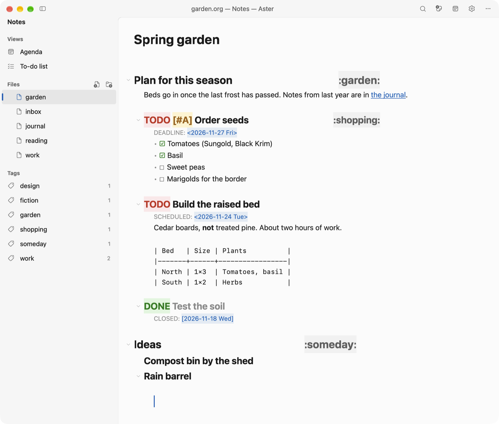

# Aster

**Notes, to-dos and plans in plain Org files, without learning Emacs.**

Aster is a desktop notes app for macOS and Linux built on [Org mode](https://orgmode.org/). Your
notes stay plain `.org` text files in a folder you choose: open them in any editor (Emacs
included), and sync them with any service you like. Aster gives them a modern, discoverable
editor with an agenda, quick capture and refile.



> **Early development (0.1.0).** Aster works for everyday notes, but expect rough edges, and
> keep a backup of notes you care about. Versions stay at 0.x until it has seen real use; see
> [CHANGELOG.md](CHANGELOG.md) for what's in each release.

## Features

- **Live preview:** Org markup is formatted as you type (`*bold*` shows as **bold**, links as
  links, `- [ ]` as a checkbox), and the raw text appears only where the cursor is.
- **Headings and lists:** fold, promote, demote and drag headings with their children; tables
  that align themselves; syntax-highlighted code blocks; inline images.
- **Tasks:** TODO states, priorities, tags, scheduled dates and deadlines, set from menus and a
  date picker, or typed as Org.
- **Agenda:** what's scheduled, due and dated across your notes folder, by day or week, plus a
  list of open to-dos and Org tag/property searches.
- **Capture, refile, archive:** add a task, note or journal entry from anywhere, and move
  headings between files.
- **Your folder, your files:** Aster watches the folder, so changes from Emacs or a sync service
  show up straight away. It stores nothing in your notes folder.
- **Discoverable:** a command palette lists every command with its shortcut, and a slash menu
  inserts headings, to-dos, tables, dates and more. Optional Emacs and Vim keys.

## Installing

Download the package for your system from the
[latest release](https://github.com/systemicdream/Aster/releases/latest):

| System | Package | Install |
|---|---|---|
| macOS 11+ (Apple silicon, Intel) | `Aster-<version>-macos-universal.dmg` | Drag Aster to Applications (first launch: see below) |
| Linux (any distribution) | `Aster-<version>-x86_64.flatpak` | `flatpak install --user Aster-<version>-x86_64.flatpak` |
| Debian 12+, Ubuntu 22.04+ | `aster_<version>_amd64.deb` | `sudo apt install ./aster_<version>_amd64.deb` |
| Fedora | `aster-<version>-1.x86_64.rpm` | `sudo dnf install ./aster-<version>-1.x86_64.rpm` |
| Other Linux | `aster-<version>-linux-x86_64.tar.gz` | Extract, then `./install.sh` |

`SHA256SUMS` in each release lets you check your download.

**macOS, first launch:** Aster isn't notarized by Apple yet, so macOS stops it the first time.
Open it once, then go to **System Settings → Privacy & Security** and click **Open Anyway**.

**Linux:** Aster needs a Wayland session (X11 isn't supported). The Flatpak is the recommended
package; it isn't on Flathub yet, so install new versions by downloading them the same way.

**Windows** isn't supported yet.

### Updates and privacy

Aster checks GitHub once a day for a new version and tells you when there is one (turn this off
in Settings → About). The request carries only Aster's version, nothing about you or your notes.

If Aster crashes, it keeps a report on your computer and offers to open a GitHub issue with it
the next time it starts. You see the report before anything is sent, and nothing is sent unless
you choose to.

## Getting started

Open Aster and pick a folder for your notes (or an existing folder of `.org` files). The sidebar
lists its files and tags. A few shortcuts to start with (Cmd on macOS, Ctrl on Linux):

| Keys | Action |
|---|---|
| Cmd/Ctrl+Shift+P | Command palette: every command with its shortcut |
| Cmd/Ctrl+P | Go to file |
| Cmd/Ctrl+N | Capture a task, note or journal entry |
| Cmd/Ctrl+Shift+A | Agenda |
| `/` | Slash menu: headings, to-dos, lists, tables, code, dates… |
| Cmd/Ctrl+Enter | Tick a checkbox, or cycle a heading's TODO state |

Files save automatically a second after you stop typing, and on quit.

<details>
<summary><strong>All keyboard shortcuts</strong></summary>

| Keys | Action |
|---|---|
| Cmd/Ctrl+Z, Cmd/Ctrl+Shift+Z (Ctrl+Y on Linux) | Undo, redo |
| Cmd/Ctrl+Enter | Toggle checkbox on this line, else cycle the heading's TODO state |
| Cmd/Ctrl+Shift+Enter | Cycle TODO state backwards |
| Alt+Enter | New sibling heading after this subtree |
| Tab, Shift+Tab (on a heading line) | Demote, promote heading with its children |
| Cmd/Ctrl+], Cmd/Ctrl+[ | Demote, promote the current subtree from anywhere in it |
| Alt+Up, Alt+Down | Move subtree among its siblings |
| Click the arrow left of a heading | Fold / unfold it |
| Cmd/Ctrl+Alt+[, Cmd/Ctrl+Alt+] | Fold, unfold the current heading |
| Cmd/Ctrl+K then Cmd/Ctrl+0 / Cmd/Ctrl+J | Fold all, unfold all |
| Alt+←/→ (macOS), Ctrl+←/→ (Linux) | Move by word (add Shift to select; Backspace/Delete to delete) |
| Double-click, triple-click | Select word, line |
| Cmd/Ctrl+F, Cmd+Alt+F (macOS) / Ctrl+H (Linux) | Find, find and replace |
| Cmd/Ctrl+G, Cmd/Ctrl+Shift+G | Next, previous match |
| Cmd/Ctrl+O, Cmd/Ctrl+S, Cmd/Ctrl+Shift+S | Open, save, save as |
| Cmd/Ctrl+Q | Quit |
| Click a checkbox | Tick / untick it |
| Cmd/Ctrl+click a link | Follow it (headings and `id:` in the file; web links, files) |
| Tab, Shift+Tab (in a table) | Align the table and move to the next / previous cell |
| Cmd/Ctrl+Shift+P | Command palette: every command with its shortcut |
| Cmd/Ctrl+Shift+O | Open a notes folder |
| Cmd/Ctrl+P | Go to file (fuzzy, by name or `#+TITLE`) |
| Cmd/Ctrl+Shift+F | Search all files |
| Cmd/Ctrl+B | Show / hide the sidebar (file tree and tags) |
| Cmd/Ctrl+Shift+A, Cmd/Ctrl+Shift+T | Agenda, to-do list |
| Cmd/Ctrl+N | Capture a task, note or journal entry |
| Cmd/Ctrl+Shift+R | Refile the heading at the cursor |
| Click a TODO keyword, priority, tag or date | Change it from a menu / date picker |
| Right-click a heading, or Cmd/Ctrl+. | Heading menu (state, priority, tags, schedule, deadline, move…) |
| `/` at the start of a line or after a space | Slash menu: headings, to-dos, lists, tables, code, quotes, dates… |
| Drag the arrow left of a heading | Move it (and its children); drag sideways to change its level |
| Click a "▸ Properties" chip | Show / hide a property drawer |

In the agenda: `j`/`k` move, Enter opens, `x` marks done, `d`/`w`/`t`/`s` switch views,
`b`/`f` step, `.` jumps to today.

</details>

## How Aster works with your files

- **Plain Org, always.** Aster reads and writes ordinary Org syntax, so a file looks the same in
  Emacs. Saves are atomic (written to a temporary file, then swapped in).
- **Changes from elsewhere.** If a file you have unsaved edits in changes on disk, Aster asks
  which version to keep. Sync-conflict copies are marked ⚠.
- **Links across files.** `id:` links and `file:other.org::*Heading` links work across the
  folder.
- **Agenda files.** Capture adds to `inbox.org`, or a timestamped entry under today in
  `journal.org`. Archive moves a heading to `<file>_archive` with Org's archive properties.
- **Startup folding.** A file with `#+STARTUP: overview` opens with every heading folded.

## Reporting problems

Found a bug or something confusing? [Open an issue](https://github.com/systemicdream/Aster/issues)
(Settings → About → **Report a problem** fills in your Aster version and system for you).

## Building from source

Aster is written in Rust with [GPUI](https://www.gpui.rs/). You need Rust (the version is pinned
in `rust-toolchain.toml`; rustup installs it automatically).

- **macOS:** Xcode command line tools.
- **Linux (Wayland):** `libxkbcommon-dev libxkbcommon-x11-dev libwayland-dev libfontconfig-dev
  libfreetype-dev libvulkan-dev pkg-config` on Debian/Ubuntu, or `libxkbcommon-devel
  libxkbcommon-x11-devel wayland-devel fontconfig-devel freetype-devel vulkan-loader-devel` on
  Fedora. (`libxkbcommon-x11` is only needed to link; Aster doesn't use X11.)

```sh
cargo run -p aster-app                     # reopens your last folder/file, or the welcome screen
cargo run -p aster-app -- ~/notes          # open a folder of .org files
cargo run -p aster-app -- path/to/notes.org
cargo test --workspace
```

To install your build:

```sh
scripts/bundle-macos.sh     # macOS: builds target/release/Aster.app (drag it to /Applications)
scripts/install-linux.sh    # Linux: installs to ~/.local/bin with a launcher entry and icon
```

More for contributors:

- [docs/PLAN.md](docs/PLAN.md): the roadmap
- [docs/DESIGN.md](docs/DESIGN.md): how the interface is designed
- [docs/decisions](docs/decisions): architecture decisions
- [docs/RELEASING.md](docs/RELEASING.md): versioning and building release packages

## License

Aster is released under the [MIT License](LICENSE).
